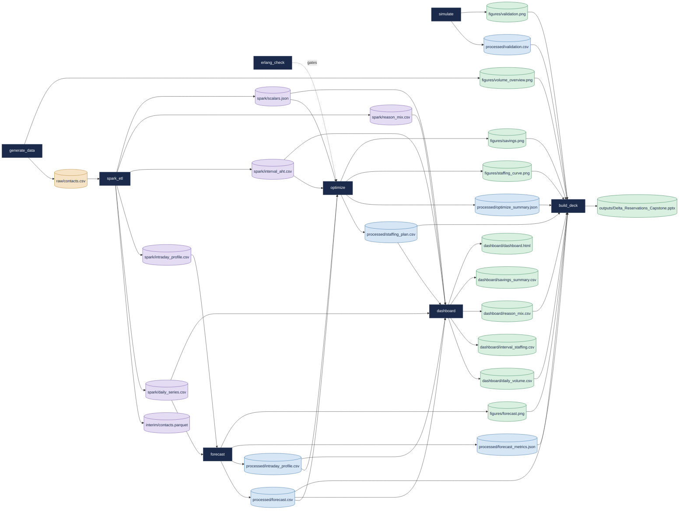

# Data dictionary

Generated from [`metadata/catalog.yaml`](metadata/catalog.yaml) by `python -m src.catalog`; do not edit by hand (`tests/test_catalog.py` fails if this file is out of date).

Every dataset the pipeline reads or writes, with its producer, consumers, grain, key, row-count rule and columns. Lineage follows the Airflow DAG (Spark engine); on the default pandas engine, the stages listed as pandas-engine consumers read `contacts.csv` directly and the interim layer is not produced. All data is synthetic.

## Lineage

Cylinders are datasets (coloured by layer), boxes are tasks, dashed arrows are gates.

## Datasets

| Dataset | Layer | Path | Produced by | Consumed by | Rows | Committed |
|---|---|---|---|---|---|---|
| [`contacts`](#contacts) | raw | `data/raw/contacts.csv` | `generate_data` | `spark_etl` | 3,500,000 – 5,500,000 | no |
| [`contacts_parquet`](#contacts_parquet) | interim | `data/interim/contacts.parquet` | `spark_etl` | — (terminal) | 3,500,000 – 5,500,000 | no |
| [`spark_daily_series`](#spark_daily_series) | interim | `data/interim/spark/daily_series.csv` | `spark_etl` | `forecast`, `dashboard` | 365 | no |
| [`spark_intraday_profile`](#spark_intraday_profile) | interim | `data/interim/spark/intraday_profile.csv` | `spark_etl` | `forecast` | 48 | no |
| [`spark_interval_aht`](#spark_interval_aht) | interim | `data/interim/spark/interval_aht.csv` | `spark_etl` | `optimize`, `dashboard` | 48 | no |
| [`spark_reason_mix`](#spark_reason_mix) | interim | `data/interim/spark/reason_mix.csv` | `spark_etl` | `dashboard` | 7 | no |
| [`spark_scalars`](#spark_scalars) | interim | `data/interim/spark/scalars.json` | `spark_etl` | `optimize`, `dashboard` |  | no |
| [`forecast`](#forecast) | processed | `data/processed/forecast.csv` | `forecast` | `optimize`, `dashboard`, `build_deck` | 60 | yes |
| [`intraday_profile`](#intraday_profile) | processed | `data/processed/intraday_profile.csv` | `forecast` | `optimize`, `dashboard` | 48 | yes |
| [`forecast_metrics`](#forecast_metrics) | processed | `data/processed/forecast_metrics.json` | `forecast` | `build_deck` |  | yes |
| [`staffing_plan`](#staffing_plan) | processed | `data/processed/staffing_plan.csv` | `optimize` | `dashboard`, `build_deck` | 1,440 | yes |
| [`optimize_summary`](#optimize_summary) | processed | `data/processed/optimize_summary.json` | `optimize` | `build_deck` |  | yes |
| [`validation`](#validation) | processed | `data/processed/validation.csv` | `simulate` | `build_deck` | 4 | yes |
| [`daily_volume`](#daily_volume) | output | `outputs/dashboard/daily_volume.csv` | `dashboard` | `build_deck` | 395 | yes |
| [`interval_staffing`](#interval_staffing) | output | `outputs/dashboard/interval_staffing.csv` | `dashboard` | — (terminal) | 48 | yes |
| [`reason_mix`](#reason_mix) | output | `outputs/dashboard/reason_mix.csv` | `dashboard` | `build_deck` | 7 | yes |
| [`savings_summary`](#savings_summary) | output | `outputs/dashboard/savings_summary.csv` | `dashboard` | — (terminal) | 4 | yes |
| [`dashboard_html`](#dashboard_html) | output | `outputs/dashboard/dashboard.html` | `dashboard` | — (terminal) |  | yes |
| [`fig_volume_overview`](#fig_volume_overview) | output | `outputs/figures/volume_overview.png` | `generate_data` | `build_deck` |  | yes |
| [`fig_forecast`](#fig_forecast) | output | `outputs/figures/forecast.png` | `forecast` | `build_deck` |  | yes |
| [`fig_validation`](#fig_validation) | output | `outputs/figures/validation.png` | `simulate` | `build_deck` |  | yes |
| [`fig_staffing_curve`](#fig_staffing_curve) | output | `outputs/figures/staffing_curve.png` | `optimize` | `build_deck` |  | yes |
| [`fig_savings`](#fig_savings) | output | `outputs/figures/savings.png` | `optimize` | `build_deck` |  | yes |
| [`deck`](#deck) | output | `outputs/Delta_Reservations_Capstone.pptx` | `build_deck` | — (terminal) |  | yes |

## Raw

### contacts

Synthetic, seeded contact log for the ATL reservations center (git-ignored; regenerated by generate_data).

- **Path:** `data/raw/contacts.csv` (csv; git-ignored, regenerated)
- **Produced by:** `generate_data`
- **Consumed by:** `spark_etl` · pandas engine: `forecast`, `optimize`, `dashboard`
- **Grain:** one row per inbound phone contact
- **Primary key:** `contact_id`
- **Rows:** 3,500,000 (`CONTACTS_MIN`) to 5,500,000 (`CONTACTS_MAX`)

| Column | Type | Unit | Allowed / range | Nullable | Description |
|---|---|---|---|---|---|
| `contact_id` | string |  | `^CT-[0-9]{7,}$` | no | Sequential contact id, CT- plus at least 7 digits. |
| `timestamp` | datetime |  |  | no | Arrival time, to the second. |
| `date` | date |  |  | no | Calendar date of the arrival. |
| `interval_start` | datetime |  |  | no | Arrival time floored to its 30-minute planning interval. |
| `hour` | integer | hour of day | 0 – 23 | no | Hour of the arrival. |
| `day_of_week` | string |  | `Monday`, `Tuesday`, `Wednesday`, `Thursday`, `Friday`, `Saturday`, `Sunday` | no | Weekday name of the arrival. |
| `contact_reason` | string |  | `Booking_Change`, `IROP_Rebooking`, `Refunds`, `SkyMiles`, `Baggage`, `Seat_Upgrade`, `General_Inquiry` | no | Why the customer called. |
| `customer_segment` | string |  | `General`, `Silver`, `Gold`, `Platinum`, `Diamond` | no | SkyMiles tier. |
| `handle_time_seconds` | integer | seconds | 30 (`HANDLE_TIME_MIN`) – 3,600 (`HANDLE_TIME_MAX`) | no | Talk plus after-call work for this contact (lognormal, clipped). |
| `irop_flag` | boolean |  |  | no | True if the contact arrived on an IROP (irregular operations) day. |
| `resolved_first_contact` | boolean |  |  | no | Resolved on this contact; never true for abandoned or repeat contacts. |
| `repeat_contact` | boolean |  |  | no | Follow-up to an earlier unresolved contact. |
| `abandoned` | boolean |  |  | no | Caller hung up before being answered. |

## Interim (Spark engine)

### contacts_parquet

Cleaned, typed copy of contacts.csv (a directory of Parquet part files); read back inside spark_etl to build the aggregates.

- **Path:** `data/interim/contacts.parquet` (parquet; git-ignored, regenerated)
- **Produced by:** `spark_etl`
- **Consumed by:** none (terminal)
- **Grain:** one row per inbound phone contact
- **Primary key:** `contact_id`
- **Rows:** 3,500,000 (`CONTACTS_MIN`) to 5,500,000 (`CONTACTS_MAX`)

| Column | Type | Unit | Allowed / range | Nullable | Description |
|---|---|---|---|---|---|
| `contact_id` | string |  | `^CT-[0-9]{7,}$` | no | Sequential contact id, CT- plus at least 7 digits. |
| `timestamp` | datetime |  |  | no | Arrival time, to the second. |
| `date` | date |  |  | no | Calendar date of the arrival. |
| `interval_start` | datetime |  |  | no | Arrival time floored to its 30-minute planning interval. |
| `hour` | integer | hour of day | 0 – 23 | no | Hour of the arrival. |
| `day_of_week` | string |  | `Monday`, `Tuesday`, `Wednesday`, `Thursday`, `Friday`, `Saturday`, `Sunday` | no | Weekday name of the arrival. |
| `contact_reason` | string |  | `Booking_Change`, `IROP_Rebooking`, `Refunds`, `SkyMiles`, `Baggage`, `Seat_Upgrade`, `General_Inquiry` | no | Why the customer called. |
| `customer_segment` | string |  | `General`, `Silver`, `Gold`, `Platinum`, `Diamond` | no | SkyMiles tier. |
| `handle_time_seconds` | integer | seconds | 30 (`HANDLE_TIME_MIN`) – 3,600 (`HANDLE_TIME_MAX`) | no | Talk plus after-call work for this contact (lognormal, clipped). |
| `irop_flag` | boolean |  |  | no | True if the contact arrived on an IROP (irregular operations) day. |
| `resolved_first_contact` | boolean |  |  | no | Resolved on this contact; never true for abandoned or repeat contacts. |
| `repeat_contact` | boolean |  |  | no | Follow-up to an earlier unresolved contact. |
| `abandoned` | boolean |  |  | no | Caller hung up before being answered. |
| `interval_index` | integer | half-hour of day | 0 – 47 | no | Planning interval of the day derived from interval_start (hour * 2 + [minute = 30]). |

### spark_daily_series

Daily contact totals and IROP flags (the forecast's training series and the dashboard's actuals).

- **Path:** `data/interim/spark/daily_series.csv` (csv; git-ignored, regenerated)
- **Produced by:** `spark_etl`
- **Consumed by:** `forecast`, `dashboard`
- **Grain:** one row per day of history
- **Primary key:** `ds`
- **Rows:** 365 (`SIM_DAYS`)

| Column | Type | Unit | Allowed / range | Nullable | Description |
|---|---|---|---|---|---|
| `ds` | date |  |  | no | Calendar date. |
| `y` | integer | contacts | ≥ 0 | no | Contacts that day. |
| `irop_flag` | boolean |  |  | no | True if the day was an IROP day. |

### spark_intraday_profile

Average share of a day's contacts that lands in each half-hour (fractions sum to 1).

- **Path:** `data/interim/spark/intraday_profile.csv` (csv; git-ignored, regenerated)
- **Produced by:** `spark_etl`
- **Consumed by:** `forecast`
- **Grain:** one row per half-hour of the day
- **Primary key:** `interval_index`
- **Rows:** 48 (`INTERVALS_PER_DAY`)

| Column | Type | Unit | Allowed / range | Nullable | Description |
|---|---|---|---|---|---|
| `interval_index` | integer | half-hour of day | 0 – 47 | no | Planning interval of the day. |
| `interval_start` | time_of_day |  |  | no | Interval start, HH:MM. |
| `fraction` | float | fraction | 0 – 1 | no | Share of a day's contacts in this interval. |

### spark_interval_aht

Mean handle time per half-hour on normal (non-IROP) days.

- **Path:** `data/interim/spark/interval_aht.csv` (csv; git-ignored, regenerated)
- **Produced by:** `spark_etl`
- **Consumed by:** `optimize`, `dashboard`
- **Grain:** one row per half-hour of the day
- **Primary key:** `interval_index`
- **Rows:** 48 (`INTERVALS_PER_DAY`)

| Column | Type | Unit | Allowed / range | Nullable | Description |
|---|---|---|---|---|---|
| `interval_index` | integer | half-hour of day | 0 – 47 | no | Planning interval of the day. |
| `aht_seconds` | float | seconds | 30 (`HANDLE_TIME_MIN`) – 3,600 (`HANDLE_TIME_MAX`) | no | Average handle time in that interval on normal days. |

### spark_reason_mix

Contacts, average handle time and repeat rate per contact reason over the full year.

- **Path:** `data/interim/spark/reason_mix.csv` (csv; git-ignored, regenerated)
- **Produced by:** `spark_etl`
- **Consumed by:** `dashboard`
- **Grain:** one row per contact reason
- **Primary key:** `reason`
- **Rows:** 7 (`N_REASONS`)

| Column | Type | Unit | Allowed / range | Nullable | Description |
|---|---|---|---|---|---|
| `reason` | string |  | `Booking_Change`, `IROP_Rebooking`, `Refunds`, `SkyMiles`, `Baggage`, `Seat_Upgrade`, `General_Inquiry` | no | Contact reason. |
| `contacts` | integer | contacts | ≥ 0 | no | Contacts with this reason. |
| `avg_AHT` | float | seconds | 30 (`HANDLE_TIME_MIN`) – 3,600 (`HANDLE_TIME_MAX`) | no | Average handle time, rounded to 0.1 s. |
| `repeat_rate` | float | fraction | 0 – 1 | no | Share of these contacts that were repeats, rounded to 4 dp. |

### spark_scalars

Single-number aggregates: total contacts, IROP handle time and the app-deflectable share.

- **Path:** `data/interim/spark/scalars.json` (json; git-ignored, regenerated)
- **Produced by:** `spark_etl`
- **Consumed by:** `optimize`, `dashboard`
- **Grain:** one JSON object

| Column | Type | Unit | Allowed / range | Nullable | Description |
|---|---|---|---|---|---|
| `n_contacts` | integer | contacts | 3,500,000 (`CONTACTS_MIN`) – 5,500,000 (`CONTACTS_MAX`) | no | Rows in the cleaned Parquet. |
| `aht_irop` | float | seconds | 30 (`HANDLE_TIME_MIN`) – 3,600 (`HANDLE_TIME_MAX`) | no | Mean handle time on IROP days. |
| `deflectable_share` | float | fraction | 0 – 1 | no | Share of normal-day contacts whose reason the app could handle. |

## Processed

### forecast

Daily contact forecast with a 95% interval; actuals filled in for the test window.

- **Path:** `data/processed/forecast.csv` (csv; committed)
- **Produced by:** `forecast`
- **Consumed by:** `optimize`, `dashboard`, `build_deck`
- **Grain:** one row per day of the held-out test window plus the future horizon
- **Primary key:** `date`
- **Rows:** 60 (`TEST_DAYS + FUTURE_DAYS`)

| Column | Type | Unit | Allowed / range | Nullable | Description |
|---|---|---|---|---|---|
| `date` | date |  |  | no | Forecast date (consecutive, no gaps). |
| `forecast` | integer | contacts | ≥ 0 | no | Point forecast (Prophet yhat, rounded). |
| `forecast_lower` | integer | contacts | ≥ 0 | no | Lower bound of the 95% interval (clipped at 0). |
| `forecast_upper` | integer | contacts | ≥ 0 | no | Upper bound of the 95% interval. |
| `actual` | integer | contacts | ≥ 0 | yes | Actual contacts on test days; empty on future days. |
| `segment` | string |  | `test`, `future` | no | Held-out test day or future (forecast-only) day. |

### intraday_profile

Intraday profile used to split each daily forecast into 48 half-hours (fractions sum to 1).

- **Path:** `data/processed/intraday_profile.csv` (csv; committed)
- **Produced by:** `forecast`
- **Consumed by:** `optimize`, `dashboard`
- **Grain:** one row per half-hour of the day
- **Primary key:** `interval_index`
- **Rows:** 48 (`INTERVALS_PER_DAY`)

| Column | Type | Unit | Allowed / range | Nullable | Description |
|---|---|---|---|---|---|
| `interval_index` | integer | half-hour of day | 0 – 47 | no | Planning interval of the day. |
| `interval_start` | time_of_day |  |  | no | Interval start, HH:MM. |
| `fraction` | float | fraction | 0 – 1 | no | Share of a day's contacts in this interval. |

### forecast_metrics

Forecast accuracy on the held-out month, split into normal, holiday and IROP days.

- **Path:** `data/processed/forecast_metrics.json` (json; committed)
- **Produced by:** `forecast`
- **Consumed by:** `build_deck`
- **Grain:** one JSON object

| Column | Type | Unit | Allowed / range | Nullable | Description |
|---|---|---|---|---|---|
| `backend` | string |  | `prophet`, `sarima` | no | Model that produced the forecast. |
| `mape_all` | float | percent | ≥ 0 | no | Mean absolute percentage error over every test day. |
| `rmse_all` | float | contacts | ≥ 0 | no | Root mean squared error over every test day. |
| `mape_normal` | float | percent | ≥ 0 | no | MAPE on normal (non-holiday, non-IROP) test days. |
| `rmse_normal` | float | contacts | ≥ 0 | no | RMSE on normal test days. |
| `n_test` | integer | days | ≥ 0 | no | Test days. |
| `n_normal` | integer | days | ≥ 0 | no | Normal test days. |
| `n_holiday` | integer | days | ≥ 0 | no | Holiday test days. |
| `n_irop` | integer | days | ≥ 0 | no | IROP test days. |

### staffing_plan

Erlang C staffing for every future half-hour: volume, load, agents and predicted service.

- **Path:** `data/processed/staffing_plan.csv` (csv; committed)
- **Produced by:** `optimize`
- **Consumed by:** `dashboard`, `build_deck`
- **Grain:** one row per 30-minute interval of the future horizon
- **Primary key:** `date`, `interval_index`
- **Rows:** 1,440 (`FUTURE_DAYS * INTERVALS_PER_DAY`)

| Column | Type | Unit | Allowed / range | Nullable | Description |
|---|---|---|---|---|---|
| `date` | date |  |  | no | Future date. |
| `interval_index` | integer | half-hour of day | 0 – 47 | no | Planning interval of the day. |
| `interval_start` | time_of_day |  |  | no | Interval start, HH:MM. |
| `volume` | float | contacts | ≥ 0 | no | Forecast contacts in the interval (daily forecast x intraday fraction). |
| `aht_seconds` | float | seconds | 30 (`HANDLE_TIME_MIN`) – 3,600 (`HANDLE_TIME_MAX`) | no | Expected handle time for the interval. |
| `offered_load_erlangs` | float | erlangs | ≥ 0 | no | Work arriving: volume x AHT / interval length. |
| `required_agents` | integer | agents | ≥ 1 | no | Fewest agents on the phones meeting the service and occupancy targets (Erlang C). |
| `scheduled_agents` | integer | agents | ≥ 1 | no | Required agents grossed up for shrinkage. |
| `predicted_sl` | float | fraction | 0.8 (`TARGET_SL`) – 1 | no | Predicted share answered within the target time at the required agents. |
| `predicted_asa_seconds` | float | seconds | ≥ 0 | no | Predicted average speed of answer. |
| `predicted_occupancy` | float | fraction | 0 – 0.9 (`MAX_OCCUPANCY`) | no | Predicted share of agent time on calls. |

### optimize_summary

Agent-hours and cost for the optimized plan and both baselines, plus the deflection and IROP scenarios.

- **Path:** `data/processed/optimize_summary.json` (json; committed)
- **Produced by:** `optimize`
- **Consumed by:** `build_deck`
- **Grain:** one JSON object

| Column | Type | Unit | Allowed / range | Nullable | Description |
|---|---|---|---|---|---|
| `n_days` | integer | days | ≥ 1 | no | Days in the staffing horizon. |
| `cost.opt_hours` | float | agent-hours | ≥ 0 | no | Scheduled agent-hours of the optimized plan. |
| `cost.opt_cost` | float | USD | ≥ 0 | no | Optimized agent-hours x hourly cost. |
| `cost.peak_scheduled` | integer | agents | ≥ 1 | no | Busiest half-hour's scheduled agents (the naive baseline's headcount). |
| `cost.flat_hours` | float | agent-hours | ≥ 0 | no | Naive baseline: peak headcount in every interval, 24/7. |
| `cost.flat_cost` | float | USD | ≥ 0 | no | Naive baseline cost. |
| `cost.saved_hours` | float | agent-hours |  | no | Naive minus optimized agent-hours. |
| `cost.saved_dollars` | float | USD |  | no | Savings vs the naive baseline. |
| `cost.pct_reduction` | float | fraction | 0 – 1 | no | Agent-hour reduction vs the naive baseline. |
| `cost.block_hours` | integer | hours | ≥ 1 | no | Shift length of the realistic baseline. |
| `cost.realistic_hours` | float | agent-hours | ≥ 0 | no | Realistic baseline: each shift staffed to its busiest half-hour. |
| `cost.realistic_cost` | float | USD | ≥ 0 | no | Realistic baseline cost. |
| `cost.realistic_saved_hours` | float | agent-hours |  | no | Realistic minus optimized agent-hours. |
| `cost.realistic_saved_dollars` | float | USD |  | no | Savings vs the realistic baseline (the headline figure). |
| `cost.realistic_pct_reduction` | float | fraction | 0 – 1 | no | Agent-hour reduction vs the realistic baseline. |
| `deflectable_share` | float | fraction | 0 – 1 | no | Share of normal-day contacts the app could handle. |
| `deflection_factor` | float | fraction | 0 – 1 | no | Volume multiplier after deflection. |
| `def_hours` | float | agent-hours | ≥ 0 | no | Optimized agent-hours with deflection. |
| `def_saved_hours` | float | agent-hours |  | no | Further agent-hours saved by deflection. |
| `def_saved_dollars` | float | USD |  | no | Further savings from deflection. |
| `aht_irop` | float | seconds | 30 (`HANDLE_TIME_MIN`) – 3,600 (`HANDLE_TIME_MAX`) | no | Handle time used for the IROP stress day. |
| `irop_peak` | integer | agents | ≥ 1 | no | Peak required agents on the IROP stress day. |
| `normal_peak` | integer | agents | ≥ 1 | no | Peak required agents on an average forecast day. |
| `irop_day_hours` | float | agent-hours | ≥ 0 | no | Scheduled agent-hours of the IROP stress day. |
| `normal_day_hours` | float | agent-hours | ≥ 0 | no | Scheduled agent-hours of an average forecast day. |
| `opt_min_sl` | float | fraction | 0.8 (`TARGET_SL`) – 1 | no | Lowest predicted service level in any interval of the plan. |
| `opt_mean_occ` | float | fraction | 0 – 1 | no | Unweighted mean predicted occupancy over staffed intervals. |
| `flat_occ_min` | float | fraction | 0 – 1 | no | Naive baseline's lowest interval occupancy. |
| `flat_occ_mean` | float | fraction | 0 – 1 | no | Naive baseline's mean interval occupancy. |
| `flat_occ_max` | float | fraction | 0 – 1 | no | Naive baseline's highest interval occupancy. |

### validation

Erlang C predictions next to SimPy measurements (mean of the replications) per load scenario.

- **Path:** `data/processed/validation.csv` (csv; committed)
- **Produced by:** `simulate`
- **Consumed by:** `build_deck`
- **Grain:** one row per simulated load scenario
- **Primary key:** `name`
- **Rows:** 4 (`N_SIM_SCENARIOS`)

| Column | Type | Unit | Allowed / range | Nullable | Description |
|---|---|---|---|---|---|
| `name` | string |  | `low`, `medium`, `high`, `peak` | no | Scenario. |
| `load` | float | erlangs | ≥ 0 | no | Offered load. |
| `agents` | integer | agents | ≥ 1 | no | Agents simulated. |
| `pred_sl` | float | fraction | 0 – 1 | no | Erlang C service level. |
| `sim_sl` | float | fraction | 0 – 1 | no | Simulated service level (mean of replications). |
| `sim_sl_std` | float | fraction | ≥ 0 | no | Spread of the simulated service level across replications. |
| `sim_sl_se` | float | fraction | ≥ 0 | no | Standard error of the simulated mean. |
| `pred_asa` | float | seconds | ≥ 0 | no | Erlang C average speed of answer. |
| `sim_asa` | float | seconds | ≥ 0 | no | Simulated average speed of answer. |
| `pred_occ` | float | fraction | 0 – 1 | no | Erlang C occupancy. |
| `sim_occ` | float | fraction | 0 – 1 | no | Simulated occupancy. |
| `n` | integer | contacts | ≥ 1 | no | Contacts measured across all replications. |
| `reps` | integer | replications | ≥ 1 | no | Independent replications averaged. |
| `sl_diff` | float | fraction | 0 – 0.03 (`SIM_SL_TOLERANCE`) | no | \|simulated - predicted\| service level. |

## Outputs

### daily_volume

Daily actuals with the forecast and its 95% band, for the BI forecast chart.

- **Path:** `outputs/dashboard/daily_volume.csv` (csv; committed)
- **Produced by:** `dashboard`
- **Consumed by:** `build_deck` · external: Tableau Public dashboard
- **Grain:** one row per day of history plus the future horizon
- **Primary key:** `date`
- **Rows:** 395 (`SIM_DAYS + FUTURE_DAYS`)

| Column | Type | Unit | Allowed / range | Nullable | Description |
|---|---|---|---|---|---|
| `date` | date |  |  | no | Calendar date. |
| `actual` | integer | contacts | ≥ 0 | yes | Actual contacts; empty on future days. |
| `forecast` | integer | contacts | ≥ 0 | yes | Forecast; empty before the test window. |
| `lower` | integer | contacts | ≥ 0 | yes | Lower 95% bound; empty before the test window. |
| `upper` | integer | contacts | ≥ 0 | yes | Upper 95% bound; empty before the test window. |

### interval_staffing

A typical day of the plan: mean volume, agents, service level and occupancy by half-hour.

- **Path:** `outputs/dashboard/interval_staffing.csv` (csv; committed)
- **Produced by:** `dashboard`
- **Consumed by:** none (terminal) · external: Tableau Public dashboard
- **Grain:** one row per half-hour of the day, averaged over the horizon
- **Primary key:** `interval`
- **Rows:** 48 (`INTERVALS_PER_DAY`)

| Column | Type | Unit | Allowed / range | Nullable | Description |
|---|---|---|---|---|---|
| `interval` | time_of_day |  |  | no | Interval start, HH:MM. |
| `volume` | float | contacts | ≥ 0 | no | Mean forecast contacts. |
| `required` | float | agents | ≥ 1 | no | Mean required agents. |
| `scheduled` | float | agents | ≥ 1 | no | Mean scheduled agents. |
| `SL` | float | fraction | 0.8 (`TARGET_SL`) – 1 | no | Mean predicted service level. |
| `occupancy` | float | fraction | 0 – 0.9 (`MAX_OCCUPANCY`) | no | Mean predicted occupancy. |

### reason_mix

Contacts, average handle time and repeat rate per reason, for the BI reason chart.

- **Path:** `outputs/dashboard/reason_mix.csv` (csv; committed)
- **Produced by:** `dashboard`
- **Consumed by:** `build_deck` · external: Tableau Public dashboard
- **Grain:** one row per contact reason
- **Primary key:** `reason`
- **Rows:** 7 (`N_REASONS`)

| Column | Type | Unit | Allowed / range | Nullable | Description |
|---|---|---|---|---|---|
| `reason` | string |  | `Booking_Change`, `IROP_Rebooking`, `Refunds`, `SkyMiles`, `Baggage`, `Seat_Upgrade`, `General_Inquiry` | no | Contact reason. |
| `contacts` | integer | contacts | ≥ 0 | no | Contacts with this reason. |
| `avg_AHT` | float | seconds | 30 (`HANDLE_TIME_MIN`) – 3,600 (`HANDLE_TIME_MAX`) | no | Average handle time, rounded to 0.1 s. |
| `repeat_rate` | float | fraction | 0 – 1 | no | Share of these contacts that were repeats, rounded to 4 dp. |

### savings_summary

Agent-hours, cost and volume-weighted service level of each way to staff the same forecast.

- **Path:** `outputs/dashboard/savings_summary.csv` (csv; committed)
- **Produced by:** `dashboard`
- **Consumed by:** none (terminal) · external: Tableau Public dashboard
- **Grain:** one row per staffing scenario
- **Primary key:** `scenario`
- **Rows:** 4 (`N_STAFFING_SCENARIOS`)

| Column | Type | Unit | Allowed / range | Nullable | Description |
|---|---|---|---|---|---|
| `scenario` | string |  | `Naive flat (peak 24/7)`, `Realistic (8h shifts)`, `Optimized (Erlang C)`, `Optimized + deflection` | no | Staffing approach. |
| `agent_hours` | float | agent-hours | ≥ 0 | no | Scheduled agent-hours over the horizon. |
| `cost` | float | USD | ≥ 0 | no | Agent-hours x hourly cost, rounded to whole dollars. |
| `SL` | float | fraction | 0 – 1 | no | Volume-weighted service level. |

### dashboard_html

Self-contained Plotly dashboard: KPI tiles, forecast, staffing heatmap, reason mix (embeds a per-run chart id).

- **Path:** `outputs/dashboard/dashboard.html` (html; committed)
- **Produced by:** `dashboard`
- **Consumed by:** none (terminal)

### fig_volume_overview

Daily contacts over the year with IROP days and holiday peaks marked.

- **Path:** `outputs/figures/volume_overview.png` (png; committed)
- **Produced by:** `generate_data`
- **Consumed by:** `build_deck`

### fig_forecast

History, held-out test window and forecast with its 95% band.

- **Path:** `outputs/figures/forecast.png` (png; committed)
- **Produced by:** `forecast`
- **Consumed by:** `build_deck`

### fig_validation

Erlang C vs simulated service level per load scenario.

- **Path:** `outputs/figures/validation.png` (png; committed)
- **Produced by:** `simulate`
- **Consumed by:** `build_deck`

### fig_staffing_curve

Optimized staffing across a day vs naive flat staffing and an IROP day.

- **Path:** `outputs/figures/staffing_curve.png` (png; committed)
- **Produced by:** `optimize`
- **Consumed by:** `build_deck`

### fig_savings

Cost of the four staffing scenarios.

- **Path:** `outputs/figures/savings.png` (png; committed)
- **Produced by:** `optimize`
- **Consumed by:** `build_deck`

### deck

Eight-slide executive deck with speaker notes (embeds build timestamps).

- **Path:** `outputs/Delta_Reservations_Capstone.pptx` (pptx; committed)
- **Produced by:** `build_deck`
- **Consumed by:** none (terminal)
